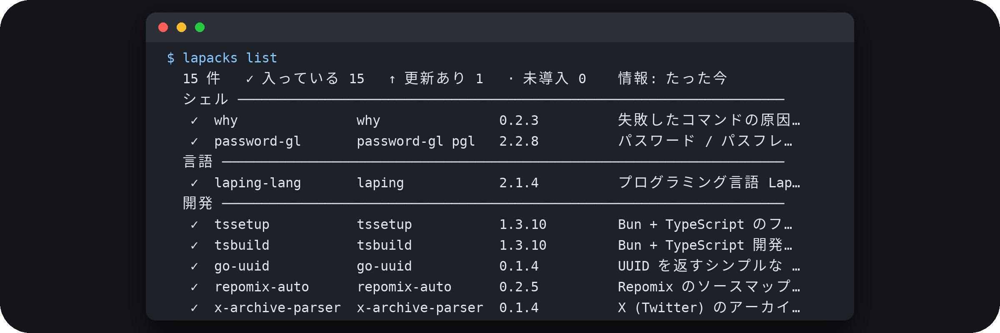

<div align="center">

<p align="center">
  
</p>

<p align="center"><a href="README.md">English</a> | <b>日本語</b></p>

<h1 align="center">Lapacks</h1>

<h3 align="center">@lapius のパッケージを、1つのコマンドで管理する。</h3>

<p align="center"><code>@lapius</code> のパッケージ（why・sca・laping・clilap など）をまとめて一覧・インストール・更新・削除できる管理 CLI です。引数なしで起動すると、キーボードで操作できる TUI が開きます。</p>

<p align="center">
  <a href="https://github.com/Lapius7/lapacks/releases"></a>
  <a href="https://www.npmjs.com/package/@lapius/lapacks"></a>
  <a href="https://nodejs.org/"></a>
  <a href="LICENSE"></a>
  <a href="https://github.com/Lapius7/lapacks/stargazers"></a>
  <a href="https://github.com/Lapius7/lapacks/commits/main"></a>
</p>

<p align="center">
  <a href="#インストール">インストール</a> ·
  <a href="#使い方">使い方</a> ·
  <a href="#しくみ">しくみ</a> ·
  <a href="#開発">開発</a>
</p>

</div>

---

## インストール

```bash
pnpm add -g @lapius/lapacks
```

> @lapius のパッケージは **pnpm 前提**です。npm と pnpm の両方に入れるとコマンドが二重になるため、`pnpm add -g` だけを使ってください。

Node.js 18 以上が必要です（Linux / macOS / Windows）。依存パッケージはありません。

## 使い方

```bash
lapacks                  # TUI を開く（端末でないときは list と同じ）
lapacks list             # 一覧（-i で入っているものだけ）
lapacks outdated         # 更新があるものだけ
lapacks info sca         # 詳しい情報（パッケージ名でもコマンド名でも可）
lapacks install why sca  # 入れる（all ですべて）
lapacks update           # 更新があるものをすべて更新（lapacks 自身も）
lapacks update laping    # 指定したものだけ更新
lapacks remove clilap    # 消す（確認あり、-y で省略）
lapacks config           # 設定の表示（config pm npm で npm に変更）
lapacks doctor           # PATH・前提ツール・コマンドの衝突を診断
```

| 別名 | 元のコマンド |
|---|---|
| `ls` `l` | `list` |
| `show` | `info` |
| `i` `add` | `install` |
| `up` `upgrade` `u` | `update` |
| `rm` `uninstall` `un` | `remove` |

### オプション

| オプション | 説明 |
|---|---|
| `-r`, `--refresh` | キャッシュを使わずレジストリから取り直す（通常は 10 分キャッシュ） |
| `-f`, `--force` | 最新でも入れ直す |
| `-y`, `--yes` | 削除の確認を省く |
| `-i`, `--installed` | 入っているものだけ表示 |
| `--json` | JSON で出力（`list` `outdated` `info`） |
| `--no-color` | 色を付けない（`NO_COLOR` でも可） |

### TUI のキー操作

| キー | 動作 |
|---|---|
| `↑` `↓` / `j` `k` | 移動（`PgUp` `PgDn` `g` `G` も可） |
| `space` | 選択 / 解除（`a` ですべて） |
| `/` | 絞り込み（名前・コマンド・説明） |
| `enter` / `→` | 詳細 |
| `i` | 入れる |
| `u` | 更新 |
| `U` | 更新があるものをすべて更新 |
| `d` / `x` | 消す |
| `r` | レジストリから取り直す |
| `l` | 直前の npm の出力を見る |
| `esc` / `q` | 戻る / 終了 |

選択しているものがあればそれらに、なければカーソルの行に対して実行します。

## しくみ

- パッケージの一覧は npm レジストリから取得します（`@lapius` で新しく公開されたものも自動で出ます）。キャッシュは `~/.cache/lapacks/`（Windows は `%LOCALAPPDATA%\lapacks\`）。
- インストールや更新は内部で `pnpm add -g @lapius/<名前>` を実行するだけです。使うパッケージマネージャは既定で pnpm です。変更するには `lapacks config pm npm` を実行します（設定ファイルに保存され、`lapacks config pm --unset` で既定に戻ります）。環境変数 `LAPACKS_PM=pnpm` / `npm` を設定した場合は、そちらが設定ファイルより優先されます。もう一方で入れたものは一覧に出ません
- 設定ファイルは `~/.config/lapacks/config.json`（`XDG_CONFIG_HOME` があればその下、Windows は `%APPDATA%\lapacks\config.json`）です。`LAPACKS_CONFIG` で場所を変えられます
- 入れたあとに、前提ツール（Python・Bun）が足りないときや、シェルの関数・エイリアスがコマンド名を隠しているときは警告します。

## 開発

```bash
node npm/package/bin/lapacks        # その場で実行
node npm/build.mjs 0.1.0 --pack     # dist/npm に .tgz を作って中身を確認
```

`v*` タグを push すると GitHub Actions が npm に公開します。

## ライセンス

MIT
